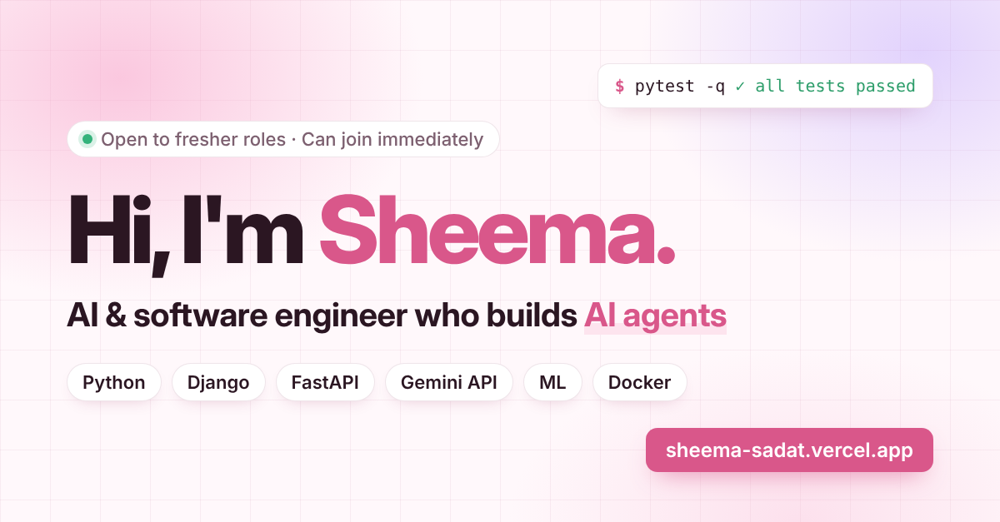

# Shaik Sheema Sadat · Portfolio

**Live site → [sheema-sadat.vercel.app](https://sheema-sadat.vercel.app)**

My personal portfolio as an AI & software engineer (B.Tech AI & ML, 2026). It brings together my projects, tech stack, education journey, certifications and resume in one place.

## What's inside

- **Projects:** AI-Based Cyber Incident Reporting System, AI Job Search Copilot, AssetLens, PulseWatch and Everyday Connect, each with highlights, tech logos and links
- **Tech stack:** tabbed view of languages, backend, frontend, AI/ML and DevOps tools
- **Journey:** education and experience timeline
- **Resume:** one-click download

## Built with

- HTML, CSS and vanilla JavaScript (no frameworks, no build step)
- Responsive layout for desktop and mobile
- Google Fonts (Plus Jakarta Sans, Inter) and Simple Icons for tech logos
- Deployed on **Vercel**, with automatic deploys on every push to `main`

## Files

| File | Purpose |
|---|---|
| `index.html` | The whole site: markup, styles and scripts |
| `resume.pdf` | Resume opened by the Download Resume buttons |
| `og-image.png` | Preview image shown when the link is shared on LinkedIn and other sites |

## Contact

- LinkedIn: [shaik-sheema-sadat](https://linkedin.com/in/shaik-sheema-sadat-8b32ab26a)
- GitHub: [Sheema6144](https://github.com/Sheema6144)
- Email: sheemasadat657@gmail.com
